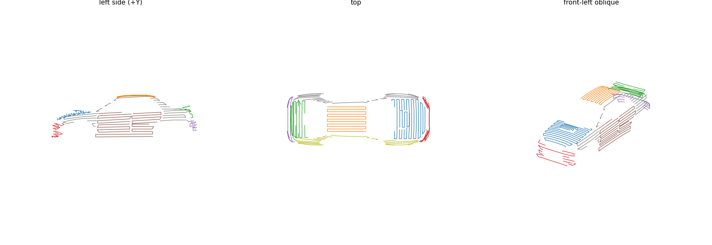
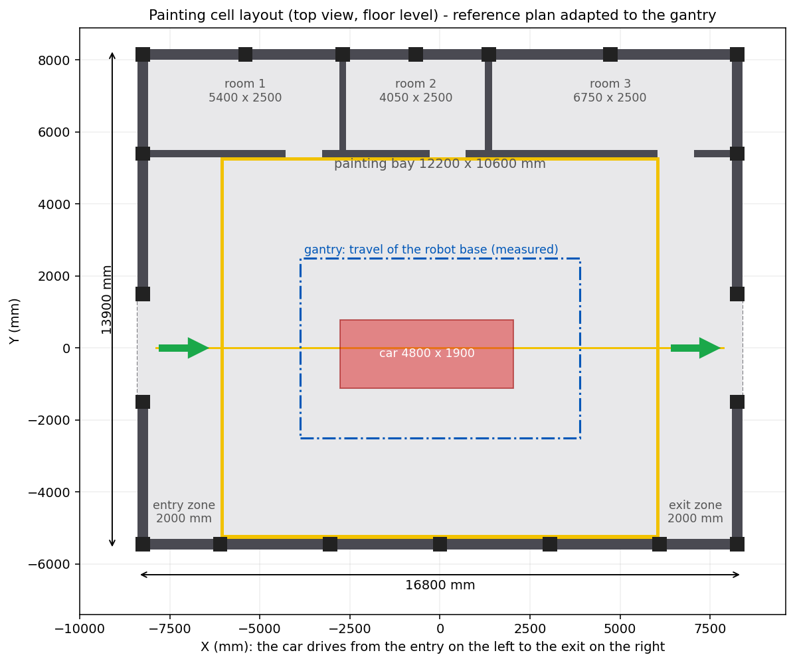

Name: Krishna Pandit
Software used: RoboDK (Python API)
Robot selected: UR10 on a Lucas RC3-1Y1R gantry

# Robotic Car Painting Cell Simulation

A simulated robotic paint cell for a full-size car body, built for the Yuktii AI Labs
*Robotics Simulation Intern* practical assessment. A **UR10** arm riding a **Lucas RC3-1Y1R
3-axis gantry** (9 synchronised joints: 6 arm + gantry X/Y/Z) carries a custom paint gun and
sprays the exterior surfaces of a ~4800 x 1900 x 1600 mm sedan, with collision checking on
every path.



*Computed zig-zag spray strokes (green) on the paint-only shell, grouped into 9 body zones.*

> **Honesty note.** The paint is shown as a **computed coverage overlay** (thin red strips
> ray-cast from the gun onto the shell), not a physical particle-spray simulation — RoboDK's
> particle spray reported 0 % "in" for every normal-size cone on this model and was too slow.
> Some surfaces are not covered and the program-to-program transit moves are only partly
> collision-checked. See [Known limitations](#known-limitations).

---

## What the cell does

1. A car shell (paint-only, 8,235 faces) sits on a `Car Frame` (front +X, left +Y, up +Z,
   tyres on Z = 0), inside a reference hall layout (12000 x 8000 mm with entry/exit zones,
   rooms, columns and floor markings).
2. The paint shell is split into smooth **patches** by surface-normal angle, the patches are
   merged into **9 body zones** (hood, roof, trunk, front, rear, left/right doors,
   left/right rails), and each zone gets **zig-zag spray curves** with surface normals,
   150 mm stand-off and 80 mm row spacing (~60 % overlap for a 120-140 mm fan).
3. For each zone, `build_zones.py` clones a working RoboDK **Curve Follow** template, searches
   for a reachable gantry/arm start pose, and generates a program `Auto_XX_<zone>` plus a master
   `Auto_Main`. Every generated program is checked against the full car with RoboDK's collision
   checker.
4. A **coverage overlay** replays the real robot poses of each stroke, ray-casts the gun axis
   onto the shell and paints the hit triangles red, then reports the painted area.

## Pipeline

```mermaid
flowchart TD
    GLB["Source car model (Sketchfab GLB)"] -->|extract_paint_surface.py| STL["car_xr_sedan*.stl (full, collisions)<br/>car_paint_only*.stl (paint shell)"]
    STL -->|segment_car_patches.py| ZONES["car_zones.json<br/>(20 patches, + cad_patches_30deg.png)"]
    ZONES -->|make_zone_curves.py| CURVES["zone_curves.json<br/>(zig-zag spray curves)"]
    CURVES -->|group_zones.py| GROUPED["zone_curves_grouped.json<br/>(9 zones)"]
    GROUPED -->|build_zones.py  (RoboDK running)| PROGS["Auto_XX_&lt;zone&gt; + Auto_Main<br/>build_report.json"]
    PROGS -->|paint_overlay.py / live_paint.py| OVERLAY["red coverage strips<br/>paint_overlay.json (coverage %)"]
    STL -.->|make_cell_layout.py| CELL["Cell Layout (hall, bay, rooms)<br/>layout_plan.png"]
```

## Repository map

```
.
├── README.md                     this file
├── LICENSE                       MIT (code) + CC BY 4.0 note (car model)
├── CREDITS.md                    model, paper and tool attributions
├── SUBMISSION_CHECKLIST.md       Google Drive layout + submission email template
├── requirements.txt
├── .gitignore
├── src/                          ALL scripts + the data they read at run time (kept flat)
│   ├── extract_paint_surface.py      step 0  full car + paint shell from the source model
│   ├── segment_car_patches.py        step 1  shell -> smooth patches -> car_zones.json
│   ├── make_zone_curves.py           step 2  patches -> zig-zag spray curves -> zone_curves.json
│   ├── group_zones.py                step 3  patches -> 9 zones -> zone_curves_grouped.json
│   ├── build_zones.py                step 4  curves -> RoboDK programs (needs RoboDK)  [imports the 3 below]
│   ├── gantry_paint_paths.py           helper: pose/IK/transit planning for the gantry+UR10
│   ├── gantry_reach.py                 helper: reach + gantry mapping + joint limits
│   ├── paint_common.py                 helper: mesh loader, ray cast, stroke -> spray pose
│   ├── GunOn.py                      step 5  paint state script (runs INSIDE RoboDK)
│   ├── gunon_tools.py                        installs/configures GunOn in the station
│   ├── paint_overlay.py                      replays strokes, ray-casts, builds red coverage strips
│   ├── live_paint.py                         reveals the strips behind the gun while Auto_Main plays
│   ├── make_cell_layout.py           step 6  builds the hall/bay/rooms + layout_plan.png
│   ├── diagnose_spray_reach.py   \
│   ├── diagnose_station.py        |  diagnostics (need RoboDK)
│   ├── check_gunon_calls.py       |
│   ├── clone_project_test.py      |
│   ├── probe_project.py           |  probe the Curve Follow template; outputs document its settings
│   ├── probe_curves.py           /
│   ├── car_xr_sedan_4800x1900x1600.stl     full car (collision body)
│   ├── car_paint_only_4800x1900x1600.stl   paint shell (8,235 faces)
│   ├── car_zones.json                      step 1 output (20 patches)
│   ├── zone_curves.json                    step 2 output
│   ├── zone_curves_grouped.json            step 3 output (FINAL input to build_zones.py)
│   └── probe_output.json / probe_curves_output.json   template-settings reference
├── docs/
│   ├── ARCHITECTURE.md           data flow + what each script reads/writes
│   ├── LESSONS_LEARNED.md        concrete gotchas from the build
│   ├── RESULTS.md                tables straight from build_report.json / paint_overlay.json
│   ├── images/                   preview/plan PNGs used in the docs
│   └── screenshots/              README listing the screenshots still to capture
├── results/
│   ├── build_report.json         the final build run (snapshot; build_zones re-writes its own in src/)
│   └── cell_layout/              generated hall STLs + layout_plan.png
└── legacy/                       earlier AMR / U-track idea + superseded experiments (not the final solution)
```

> The assembled RoboDK station (`Gantry Car Paint.rdk`) and its autosave/backup are **not**
> committed (too large, and gitignored) — they are delivered via Google Drive. Runtime output
> (`overlay/`, `paint_overlay.json`, `hop_cache.json`, `build_report.json` in `src/`, the
> `cell_layout/` in `src/`) is regenerated by the scripts and is gitignored.

## Requirements

- Python 3.10, `numpy`, `matplotlib`, `trimesh` (steps 0-1 only), and `robodk` (the RoboDK
  Python API). See `requirements.txt`.
- **RoboDK with a trial (or paid) license.** The Free license limits the Python API, which
  blocks `build_zones.py`. Needed for `build_zones.py`, `paint_overlay.py`, `live_paint.py`,
  `gunon_tools.py`, `make_cell_layout.py --import` and the diagnostics.
- Tested on Ubuntu. RoboDK version: TODO(Krishna) — fill in the exact RoboDK version you used.

### Expected RoboDK station

The scripts find items **by name**. The station must contain this tree (delivered via Google Drive):

```
Lucas RC3-1Y1R Base
└── Lucas RC3-1Y1R            (3-axis gantry: X, Y, Z)
    └── UR10 Base
        └── UR10              (6-axis arm)
            └── Paint gun     (tool; TCP at (50, 0, 450) mm, tilted 30 deg about Y vs the tool item frame)
Car Frame
├── car_xr_sedan             (full car, used for collisions)
├── car_paint_only          (paint shell)
└── Frame 4
GunOn                        (Python program item; the paint state script)
Path2 settings  +  Path2     (the working "Curve Follow" template that build_zones.py clones)
Cell Layout                  (frame holding the hall/bay/room meshes)
Auto_XX_<zone> ... + Auto_Main   (generated by build_zones.py)
```

## How to reproduce

All scripts live in `src/` and locate their data relative to their own folder, so run them
from `src/`:

```bash
cd src
```

**Step 0 - paint shell from the source model** (optional; the shipped STLs are already this output,
renamed to their final names):
```bash
python3 extract_paint_surface.py <downloaded_model.glb> --out car     # -> car_full.stl, car_paint_only.stl
```

**Step 1 - segment the shell into patches:**
```bash
python3 segment_car_patches.py car_paint_only_4800x1900x1600.stl --angle 30 --min-area 0.15
# -> car_zones.json  (+ cad_patches_30deg.png)
```

**Step 2 - zig-zag spray curves (150 mm stand-off, 80 mm rows):**
```bash
python3 make_zone_curves.py --row-step 80
# -> zone_curves.json  (+ zone_curves_preview.png)
# optional sanity check against the hand-made door path:
python3 make_zone_curves.py --validate-door probe_curves_output.json
```

**Step 3 - merge patches into 9 zones:**
```bash
python3 group_zones.py
# -> zone_curves_grouped.json  (+ zone_curves_grouped_preview.png)
```

**Step 4 - generate the RoboDK programs** (RoboDK must be running with the station open):
```bash
python3 build_zones.py --zones-json zone_curves_grouped.json --standoff 150 --main
# -> programs Auto_XX_<zone>, Auto_Main, build_report.json  (written into src/)
# useful flags: --resume  --clean  --split N  --skip <ids>  --zones <ids>  --salvage
```
Build the master program with collision-checked transit moves between programs:
```bash
python3 build_zones.py --main-only --transit --auto-order
```

**Step 5 - paint coverage overlay:**
```bash
python3 gunon_tools.py                     # install/configure the GunOn state script in the station
python3 paint_overlay.py build main        # -> src/overlay/*.stl, src/paint_overlay.json, coverage %
# then, in a SECOND terminal, while Auto_Main is playing in RoboDK:
python3 live_paint.py                       # reveals the red strips behind the gun
```

**Step 6 - cell layout:**
```bash
python3 make_cell_layout.py --fit --import  # measures the gantry travel, enlarges the bay, imports the hall
# -> src/cell_layout/*.stl, src/cell_layout/layout_plan.png
```



## Results

From `results/build_report.json` and `src/paint_overlay.json` (see [docs/RESULTS.md](docs/RESULTS.md) for the full tables):

| Zone (id) | Program(s) that passed RoboDK's collision check (valid ratio 1.0, "No problems found") |
|-----------|----------------------------------------------------------------------------------------|
| 0 hood    | `Auto_00_hood` |
| 1 roof    | `Auto_01_roof` |
| 2 trunk   | `Auto_02_trunk` |
| 3 front   | `Auto_03_front_centre_front_1` (front face) — upper part uncovered |
| 4 rear    | `Auto_04_rear_p1`, `Auto_04_rear_p2` |
| 5 left doors  | `Auto_05_left_doors` |
| 6 right doors | `Auto_06_right_doors` |
| 7 left rail   | `Auto_07_left_rail_p1`, `_p2`, `_p3`, `_p5` |
| 8 right rail  | `Auto_08_right_rail_p1`, `_p2`, `_p3`, `_p4` |

- **16 path pieces solved** and each passed RoboDK's collision check (valid ratio 1.0,
  *"No problems found for this path — No collisions detected."*).
- **Auto_Main** (as replayed by `paint_overlay.py`) calls **14 programs** — two solved pieces
  (`Auto_07_left_rail_p5`, `Auto_08_right_rail_p2`) were left out of the master program.
- **3 pieces failed** to attach/pass: `front_centre_top_5`, `left_rail_p4`, `right_rail_p5`.
- **Computed coverage: 9.75 m² of 12.73 m² of the shell = 77 %** (120 mm strips), per
  `paint_overlay.json`.
- Total solved spray-path length ≈ **150 m**.

## Known limitations

- **Not physical spray.** Paint is a computed coverage overlay (ray-cast red strips), not a
  particle-spray simulation. RoboDK's particle spray reported 0 % "in" on this model.
- **Uncovered surfaces (~23 % of the shell):** the **front upper part** (headlight/grille
  openings — strokes pass through the gaps), and parts of the rails/rockers
  (`left_rail_p4`, `right_rail_p5` failed; `right_rail_p2` and `left_rail_p5` solved but were
  dropped from Auto_Main). Rough uncovered stroke length: front ~2.0 m, left rail ~3.0 m,
  right rail ~3.1 m.
- **Transit moves between programs** are only partly collision-checked (by this project's
  planner plus RoboDK's collision-free planner / Smart Motion). Final status: TODO(Krishna).
- **Coverage figure** is for the extracted paint shell (12.73 m²), not a class-A automotive
  finish; overlap/edge effects are approximated by fixed-width strips.

## Credits and license

- Code: MIT © Krishna Pandit (see [LICENSE](LICENSE)).
- Car model: *"Generic Toyama XR Sedan"* by **mk2design**, CC BY 4.0, https://skfb.ly/6vENy
  (modified: paint shell extracted, scaled/oriented). See [CREDITS.md](CREDITS.md).
- RoboDK robot/tool library models (UR10, Lucas RC3-1Y1R, paint gun) are not included here;
  they belong to RoboDK and ship with the station via Google Drive.
- Paint-overlap idea (~60 % stroke overlap) from Chen et al., 2002 on paint-path/thickness
  planning. Exact citation: TODO(Krishna) — fill in the paper's exact title (the PDF was not in
  this folder).

## AI-assistance statement

This project was developed by **Krishna Pandit** with the help of an AI assistant
(**Claude by Anthropic**). I ran, tested and verified all results myself.

## Submission links

- GitHub: https://github.com/kk-Dollar/Car-painting-robot
- Demo video (3-7 min): TODO(Krishna)
- Technical report (PDF): TODO(Krishna)
- Google Drive folder: TODO(Krishna)

See [SUBMISSION_CHECKLIST.md](SUBMISSION_CHECKLIST.md) for the Drive layout and the submission email.
